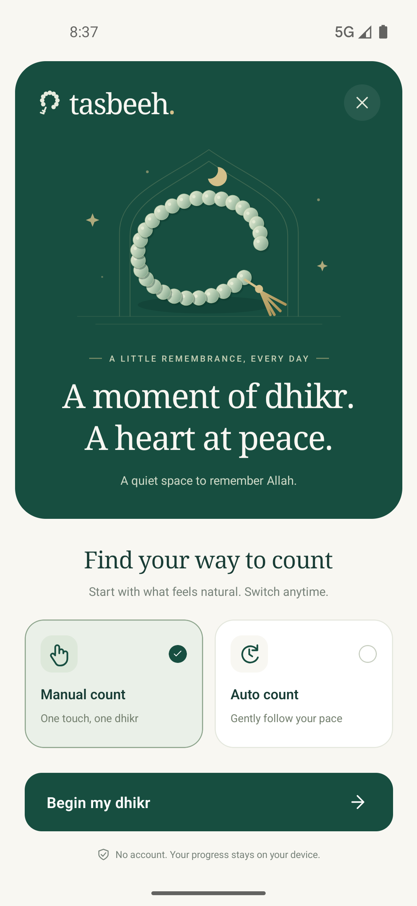
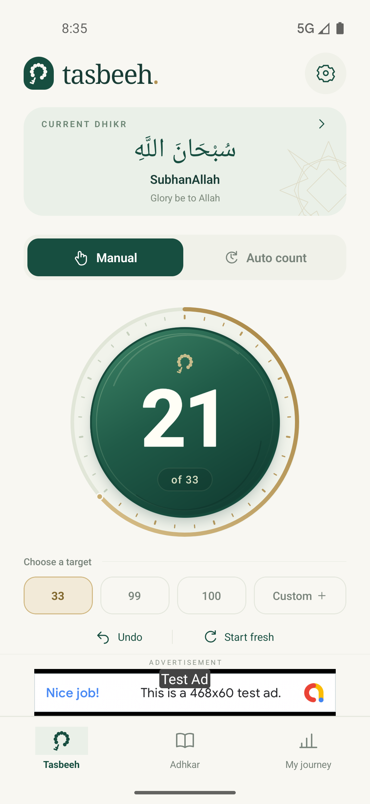
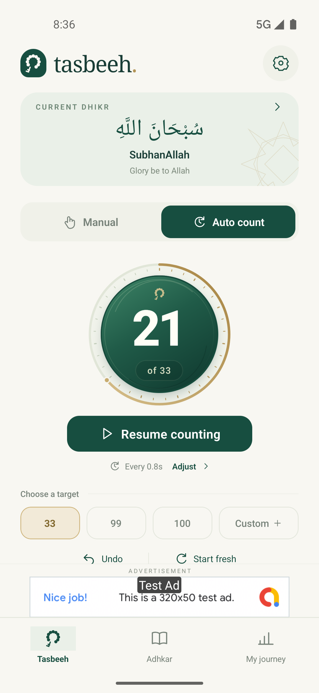
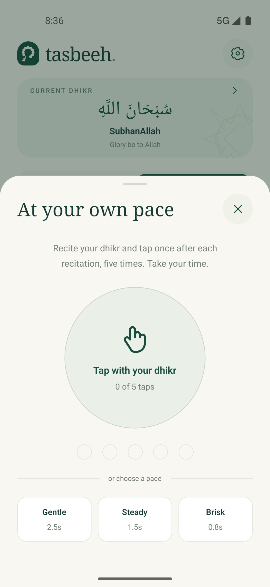
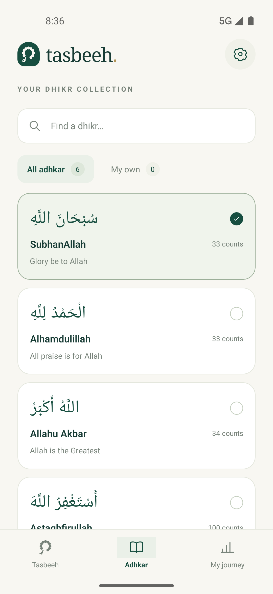
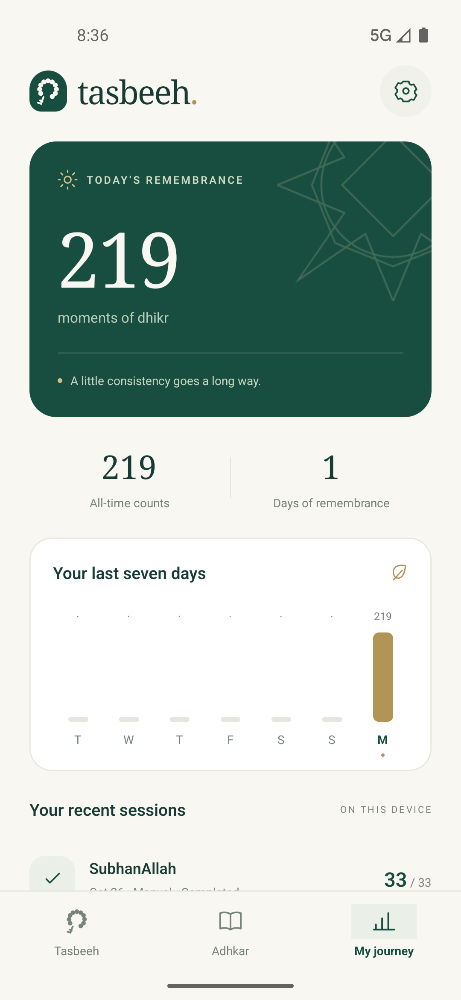
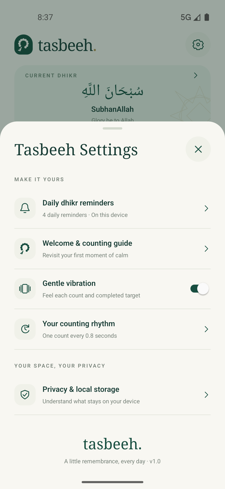

# Tasbeeh

A native, local-first dhikr companion for Android and iOS, built with React Native and TypeScript. No account, app backend, analytics service, remote font, or downloaded illustration is required.

The interface uses warm ivory, deep emerald, muted gold, original vector prayer beads and an arch motif. Screen artwork and icons are drawn with SVG; native system fonts keep the app self-contained.

## Screenshots

<table>
  <tr>
    <td align="center" valign="top">
      <strong>1. Onboarding</strong><br /><br />
      
    </td>
    <td align="center" valign="top">
      <strong>2. Manual counter</strong><br /><br />
      
    </td>
    <td align="center" valign="top">
      <strong>3. Auto counter</strong><br /><br />
      
    </td>
  </tr>
  <tr>
    <td align="center" valign="top">
      <strong>4. Pace calibration</strong><br /><br />
      
    </td>
    <td align="center" valign="top">
      <strong>5. Dhikr collection</strong><br /><br />
      
    </td>
    <td align="center" valign="top">
      <strong>6. My journey</strong><br /><br />
      
    </td>
  </tr>
  <tr>
    <td align="center" valign="top">
      <strong>7. Settings</strong><br /><br />
      
    </td>
  </tr>
</table>

## Included

- First-launch introduction with manual or auto counting.
- Manual counter with a sculpted emerald dial, bold digits, animated gold progress, tap ripple and spring feedback, undo, vibration, preset targets and custom targets from 1–9,999. Motion respects Reduce Motion; auto breathing stops while paused or in the background.
- Auto counting calibrated from five taps, or a gentle / steady / brisk preset. Calibration taps do not add to the count. Auto mode is a foreground timer, not voice recognition.
- Six built-in adhkar with Arabic, transliteration, meaning and suggested targets, plus personal entries and search.
- Daily and lifetime totals, seven-day activity and the latest 300 completed or saved sessions.
- Settings, local storage information, and Google UMP ad privacy choices where applicable.
- On-device daily dhikr reminders at 6:00 AM, 1:00 PM, 6:00 PM and 9:00 PM, with individual controls and a test notification.
- Original launcher icons and a matching iOS launch screen.

## Run

Use Node 22.11 or newer and the standard React Native native toolchains.

```sh
npm ci
npm start
```

In a second terminal:

```sh
# Android device / emulator
npm run android

# iOS: install native pods first
cd ios
pod install
cd ..
npm run ios
```

The generated workspace is `ios/TasbeehDigitalApp.xcworkspace`. The New Architecture and Hermes are enabled.

## Local data

`src/state/model.ts` owns the state transitions. `src/state/useStoredState.ts` serializes state into the `tasbeeh` AsyncStorage database. Writes run in order; loading finishes before the first save. Read errors preserve the existing data and offer a retry. Write errors appear above the counter with a retry action.

The active count, target, dhikr, mode, pace, preferences, personal entries, history and daily totals survive a restart. Resetting the counter or changing its dhikr/target saves unfinished progress as a session without subtracting from lifetime totals. Undo corrects the day on which the count was originally made, including a session spanning midnight. Reaching a target records one completed session and stops counting.

Auto mode pauses when changing tabs, opening a sheet, leaving the app or reaching the target. It never resumes silently after returning from the background or reopening the app. There is no background service or microphone permission.

Storage is local and is not a cloud backup. Uninstalling the app or clearing its data can remove progress. The app does not send dhikr entries or counting history to AdMob.

## Local dhikr reminders

Open **Settings → Daily dhikr reminders**. Enable all four reminders or select individual times. Notification permission is requested only after opting in. The titles and bodies in `src/constants/reminders.ts` match the provided messages, including emojis.

No notification package, Firebase setup, push token, APNs registration, backend, network call, foreground service or JavaScript timer is used for reminders. A small native TurboModule is generated from `src/specs/NativeDhikrReminders.ts`; rebuild the native app after adding or changing it.

- **iOS:** `UNUserNotificationCenter` schedules four repeating `UNCalendarNotificationTrigger` requests using hour/minute components in the current device time zone. Stable request IDs replace existing schedules. The app delegate allows reminder banners and sounds while the app is open.
- **Android:** `AlarmManager` schedules one next occurrence per enabled reminder. A manifest receiver displays the notification and schedules the following local calendar day. Reboot, app replacement, clock/time-zone changes and precise-alarm permission grants reconcile the saved schedules. Calendar arithmetic preserves the selected wall-clock hour across daylight-saving changes.
- **Permissions:** Android 13+ notification permission and iOS alert/sound permission are handled. Android 12+ offers a link to the system's **Alarms & reminders** access when precise delivery is unavailable. Without this access, reminders use inexact alarms and Android can delay them. `USE_EXACT_ALARM` and push notification entitlements are not requested.
- **Persistence:** The reminder catalog and selected IDs live in native SharedPreferences/UserDefaults so the OS scheduler can operate independently of the React Native UI. Returning to the app refreshes permissions and reconciles schedules without duplicates. Turning reminders off cancels pending and delivered reminder notifications. Notification denial never affects counting.
- **Test notification:** Uses the morning message with a “Test reminder” subtitle; it does not change the daily schedule.

The phone controls notification presentation: Focus/Do Not Disturb, channel settings, battery restrictions and exact-alarm access may affect delivery. A powered-off device cannot display notifications. Android force-stop clears scheduled work until the app is opened again; after a reboot, credential-protected settings are available once the phone has been unlocked.

Native Android calendar tests:

```sh
cd android
./gradlew :app:testDebugUnitTest
```

## Advertising

The native Google Mobile Ads SDK is integrated. **All builds currently use Google's demo app IDs and test ad units.** A live test banner was verified in the iPhone simulator.

- Banner: above the bottom navigation, separated from the count surface and controls. Android requests the standard 320 × 50 banner and reserves a 50 dp ad slot; iOS uses an anchored adaptive banner. The counter measures the remaining screen area so targets and undo/reset stay within reach.
- Interstitial: eligible only when the user chooses **View my journey** after completing a target. At most one per three such distinct session boundaries and no more frequently than once every two minutes. If no ad is ready, navigation continues without waiting. Pending presentation is cancelled if the user navigates, starts counting, opens another sheet or leaves the app.
- No ads on the introduction, library, journey or calibration sheet.
- Consent is gathered before SDK initialization and requests. Without connectivity or permission to request ads, the counter continues to work and the banner space shows a quiet fallback.
- Ad privacy choices are exposed in Settings when UMP requires them. Cached interstitial inventory is retired when consent is changed.

Before using real ads, replace:

1. Demo app IDs in `app.json` and `GADApplicationIdentifier` in `ios/TasbeehDigitalApp/Info.plist`.
2. The two `TestIds` in `src/services/ads.tsx` with platform-specific publisher ad unit IDs, retaining test units for development.
3. Configure the publisher's privacy messages in AdMob, and use publisher-approved store privacy disclosures. The in-app privacy explanation describes this implementation; it is not a hosted publisher privacy policy.

The Android release signing block is still the starter project's debug signing configuration. Configure your own release signing before store distribution.

## Verification

```sh
npm run lint
npx tsc --noEmit
npm test -- --runInBand
```

Tests cover count limits, one-time completion, undo, crossing midnight, saving partial sessions, custom dhikr, corrupt-data protection, persistence, calibration and foreground-only auto counting. Native iOS simulator and Android ARM64 debug builds have also been compiled successfully.

Simulator previews are in `design/previews/`. The editable app icon source is `design/app-icon.svg`; `scripts/generate_icons.py` regenerates native icons using Pillow as a development-only tool.
